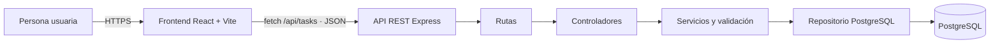

# Arquitectura de Tasking4You

## Vista general

Tasking4You es una aplicación web de tres capas. El navegador presenta la interfaz React, el backend Express expone la API y PostgreSQL conserva las tareas.

## Responsabilidades

| Capa | Ubicación | Responsabilidad |
|---|---|---|
| Interfaz | `frontend/src/` | Componentes React, estado de pantalla, navegación, accesibilidad y consumo HTTP. |
| API | `backend/src/routes/` | Define los endpoints bajo `/api`. |
| Controladores | `backend/src/controllers/` | Traduce solicitudes HTTP a operaciones de servicio y respuestas JSON. |
| Servicios | `backend/src/services/` | Valida datos y aplica reglas de tareas, sin depender de Express ni SQL. |
| Persistencia | `backend/src/repositories/` y `backend/src/config/` | Ejecuta consultas parametrizadas mediante `pg`. |
| Esquema | `backend/sql/` y `backend/migrations/` | Define la tabla y cambios versionados de la base de datos. |

## Flujo de una operación

1. React envía una solicitud a `VITE_API_URL` con `fetch`.
2. Express aplica CORS y analiza JSON.
3. La ruta dirige la solicitud al controlador correspondiente.
4. El servicio valida los campos y delega la persistencia al repositorio.
5. PostgreSQL devuelve filas; el controlador las responde como JSON con el código HTTP correspondiente.
6. React actualiza su estado o muestra el error recibido.

## API

| Método | Ruta | Uso |
|---|---|---|
| GET | `/api/health` | Comprueba la disponibilidad de API y base de datos. |
| GET | `/api/tasks` | Lista tareas. |
| POST | `/api/tasks` | Crea una tarea. |
| PATCH | `/api/tasks/:id` | Cambia uno o varios campos de una tarea. |
| DELETE | `/api/tasks/:id` | Elimina una tarea. |

Los identificadores se validan en el servicio; los valores SQL se envían como parámetros. La respuesta de error tiene formato JSON.

## Configuración y límites

- El frontend usa `VITE_API_URL` para conocer la base URL de la API.
- El backend usa `DATABASE_URL` (o variables `PG*`), `PORT`, `DB_SSL` y `FRONTEND_URL`.
- Los valores reales de conexión se definen en archivos `.env` locales ignorados por Git o en el entorno de ejecución del proveedor.
- CORS limita los orígenes permitidos a `FRONTEND_URL`.
- El acceso de usuario que existe en la interfaz es una demostración local; no constituye autenticación del backend ni separa tareas por usuario.
- El alta de servicios, DNS, subdominios, certificados y variables del proveedor de hosting pertenecen a la configuración de infraestructura, fuera de este diseño de código.

## Estructura de trabajo Git

- `main`: versión estable integrada.
- `development`: integración del trabajo revisado.
- `final`: snapshot que se presenta como entrega.
- Las ramas de funcionalidad se crean desde `development` y se integran mediante Pull Request. La rama `main` debe protegerse desde GitHub para evitar borrados o pushes accidentales.
